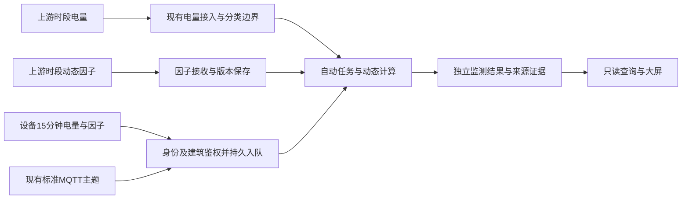

# 建筑用电动态碳监测接口

本接口提供独立监测结果，不替代正式碳核算。能源分类、有效计量关系、总分表去重、项目排除和建筑授权继续使用平台已有能力。因子是上游输入；本模块不生成发电侧因子，也不要求区域发电量。



## 口径与粒度

- 每个有效时段、去重后的电量来源分别计算 `C_i = Q_i × f_i`。汇总 `Q = ΣQ_i`、`C = ΣC_i`、`F = C/Q`。分子分母必须使用同一批来源。
- 动态排放返回 `tCO2`，因子返回 `kgCO2/kWh`，电量为 `kWh`；十进制指标以字符串传输。零用量且来源完整时排放为零、因子为空。不能将 CO2 标签直接替换成 CO2e。
- 同一时段内只有较细因子、没有相应较细电量时，对因子按覆盖时长平均后乘已有周期电量。证据保留 `timeAveraged=true`，这是输入适配的估算，不是已掌握小时用电曲线。
- 统一使用 `Asia/Shanghai` 自然小时、日、月和年，区间左闭右开；设备输入只接收已结束且对齐的15分钟时段。当前开放的日/月槽位可返回已完整计算的连续前缀，保留 `computedThrough`。小时和日结果可向上汇总，月量不拆成日量，日量不拆成小时量。
- `REVIEWED_INTERVAL` 默认复用既有审核周期量。`RAW_CUMULATIVE` 复用既有原始累计读数、差值和质量裁决，必须先计算 HOUR，再向上汇总。历史初始化计算命令会登记持续跟踪的时段任务，后续输入修订由后台重算；设备路径使用下述 `/intervals` 自动接入。查询始终只读。
- 具体测点因子优先；`pointId="*"` 是明确适用于该建筑计量边界的共同因子。已提供具体测点因子但存在缺口时拒绝计算，不以共同因子补洞。当前不自动按父表继承因子。

## HTTP 契约

路径前缀：`/v1/carbon-management/buildings/{buildingId}/dynamic-electricity`，部署如设置 `/api` context path，需要在前面追加该路径。

| 方法与路径 | 行为 |
| --- | --- |
| `POST /intervals` | 适配层提交设备15分钟电量与因子，保存输入并自动登记计算任务 |
| `POST /factors` | 导入带来源、区域、情景、单位、性质和幂等键的时段因子 |
| `POST /calculations` | 按 HOUR、DAY 或 MONTH 显式计算并保存完整结果 |
| `GET ?periodType=YEAR&period=2026` | 固定返回 12 个月的槽位 |
| `GET ?periodType=MONTH&period=2026-09` | 返回该月自然日槽位 |
| `GET /hourly?date=2026-09-01` | 返回该日 24 小时槽位，不生成小时数据 |
| `GET /results/{resultId}/evidence` | 查询同一建筑下的电量来源、因子引用和计算证据 |

写入沿用 `ENERGY_MANAGER` / `PLATFORM_ADMIN` 及碳模块建筑范围；读取另外允许授权的 `BUILDING_OWNER`。这些是平台服务入口，不是开放匿名设备入口，不能把用户凭据固化到电表。

因子导入每次不超过 3,000 条；单条时段和单次计算跨度最多 31 天，计算最多 744 个时段、5 分钟。幂等键和内容相同返回原回执；同键异文拒绝。修订采用新幂等键，且必须保持原测点和准确区间，不能通过修订制造重叠。

查询状态包括 `COMPLETE`、`ACCUMULATING`、`MISSING`、`PARTIAL`、`STALE`、`NOT_ENDED`。COMPLETE 表示整个自然槽位已覆盖，ACCUMULATING 表示当前自然槽位从起点到 computedThrough 的连续完整前缀，其余状态不输出排放和因子。电量、分类、项目、质量策略或因子版本变化后旧结果不得继续充当当前值，需显式重算。发布前复核来源版本；变化时整批拒绝发布。不同粒度已有结果按完整覆盖选取，避免同一电量重复累计。`sourceNatures` 仅表示所用因子的来源标记；电量来源另见 `electricityEvidence`，不能据此认定整批为实测数据。

输入版本另包含已确认目录绑定、已审批能源品种/用途范围、单位版本和测点原单位；原始累计路径再包含能源测点 profile 修订。目录/单位按已审批版本保守失效，不增加用户核查步骤。

设备任务按建筑和准确时段合并，修订以数据库行锁和递增版本保护。输入不完整时保持待算，只有所需计量来源配齐才发布。计算期间发生修订时旧租约不能发布。后台每秒扫描，失败延后5秒重试，30秒租约支持进程重启恢复。同批任务复用经有效期核验的目录和绑定，身份或配置摘要改变即清空，日内换版回到准确设备区间。设备数据不触发其他建筑或期间失效。配置头每30秒检查，配置改变后按现有规则重新校验。

历史审核量的版本按结果覆盖的准确时段读取当前有效事实，RAW 按准确时段并含左右锚点核对原始事实和质量/测点策略。因此共享锚点更正会使前后两个小时失效。已登记的历史计算任务自动核对来源并重算，因子修订会立即唤醒重叠任务。新设备输入声明的区间会排除重叠人工粗周期结果，配对或覆盖缺口保持缺失，防止旧粗周期值掩盖设备修订。V104旧结果需要由独立数据初始化脚本执行一次计算，建立V105时段任务和新版本摘要。

### 设备周期上传

`POST /intervals` 复用平台现有JWT、碳计算职责和建筑范围，调用方是已授权适配层。设备身份必须已在现有台账启用，设备所属建筑、协议和测点设备归属必须一致。实际硬件或网关需按此HTTP契约适配。

```json
{
  "deviceIdentity": {"type": "SERIAL_NO", "value": "meter-001"},
  "profileCode": "METER_PROFILE",
  "pointId": "POINT_ID",
  "startInclusive": "2026-10-01T00:00:00+08:00",
  "endExclusive": "2026-10-01T00:15:00+08:00",
  "revision": 1,
  "electricityKwh": "12.345",
  "factorKgCo2PerKwh": "0.54321",
  "sourceNature": "SOURCE_LABELLED",
  "sourceReference": "upstream meter interval"
}
```

电量为本时段千瓦时用量。两项可以一起上传，也可分别上传，但同一电表、区间、修订号必须配齐。同版本异值拒绝，重复值只计一次，旧版本重投不覆盖新版本。更正任一值时递增修订号并提供同版本配对值。返回PENDING仅表示输入和任务已保存，计算由后台完成。

大屏每次请求结束后间隔5秒刷新已有月/年数值，切换建筑/期间或卸载撤销旧请求和定时器。前端不做业务汇总，computedThrough只供后端计算与验收，不增加图上标签或状态样式。

### MQTT标准时段接入

平台已有 `mqtt.topics.standard-upstream` 主题接收可选的 `electricityInterval`，默认主题为 `device/telemetry/up`。信封沿用标准1.0身份、协议、事件/接收时间及序号，`metrics` 与周期载荷互斥。每条报文对应一个电表测点的15分钟区间，时间、版本、精度、单位及配对规则与HTTP时段入口一致。

```json
{
  "standardVersion": "1.0",
  "profileCode": "METER_PROFILE",
  "profileVersion": 1,
  "deviceIdentity": {"type": "SERIAL_NO", "value": "meter-001"},
  "eventTime": 1790784900000,
  "receivedTime": 1790784900000,
  "timeSource": "DEVICE_REPORTED",
  "seq": 1,
  "metrics": [],
  "electricityInterval": {
    "pointId": "PLATFORM_POINT_ID",
    "startInclusive": "2026-10-01T00:00:00+08:00",
    "endExclusive": "2026-10-01T00:15:00+08:00",
    "revision": 1,
    "electricityKwh": "1.25",
    "factorKgCo2PerKwh": "0.5",
    "electricityUnit": "kWh",
    "factorUnit": "kgCO2/kWh",
    "sourceNature": "SOURCE_LABELLED",
    "sourceReference": "upstream interval reference"
  }
}
```

建筑由已启用设备身份解析，测点必须属于同一设备、建筑和千瓦时单位。消息不携带平台用户、角色或建筑授权。后台以保留的系统标识0处理已核验设备任务，内部只读解析始终固定在任务建筑；HTTP入口继续校验当前用户职责与建筑范围。输入证据记录服务器解析的identityId和MQTT_STANDARD_V1传输来源，旧HTTP数据的JSON缺省字段仍可读取。

QoS1处理复用现有MqttConfig订阅、手动确认、重连和标准报文处理器。只有MySQL输入与任务提交成功后才返回接入成功，存储等暂时故障保留重投，非法单位、归属或同版本异值稳定拒绝。Broker PUBACK、平台保存、计算完成与大屏显示是不同阶段，接入成功回执不表示排放已经生成。周期量保存于V105当前输入，V104保存不可变动态结果，区间受理表按下述规则保留消息指纹和数值证据。

普通metrics报文继续走原数值遥测链路。V2周期载荷也已接到同一动态任务服务，使用下述V2契约；不能仅把V1报文换主题。真实设备或厂家网关的字段映射仍需独立联调。

### 现有适配器与V2周期载荷

`telemetry-adapter`使用现有字段映射表的`value_type`声明周期角色，JDBC模板与平台发布快照共用同一解析规则，不新增配置页面或数据库结构。普通映射仍为DECIMAL。平台协议映射API提供可选valueType，缺省仍为DECIMAL；旧页面更新未传类型时保留同路径/点码的原角色，避免编辑时静默降级。

| value_type | 输入及目标单位 | 含义 |
| --- | --- | --- |
| ELECTRICITY_KWH | 显式换算到kWh | 周期用电量，metric_code必须匹配既有设备用电测点别名 |
| CO2_FACTOR | kgCO2/kWh | 同区间CO2因子；不能把CO2e改名冒充CO2 |
| INTERVAL_START / INTERVAL_END | ms，不加倍率或偏移 | 设备提供的Unix毫秒时界，不能用接收时间代替 |
| INTERVAL_REVISION | 1，不加倍率或偏移 | 正整数业务修订号 |

周期模板须包含电量、因子及至少一种时界角色，各角色唯一。时界映射必需，时界只能来自设备数据；只有开始或结束时间时，按固定15分钟推导另一端。可将已有设备时间字段映射为INTERVAL_END或INTERVAL_START，不要求电表新增同义字段。INTERVAL_REVISION可省略，省略时由平台管理版本；已有显式修订继续兼容。显式修订允许两项按同修订拆分补齐；自动版本要求同包电量和因子，不用不明批次拼接新旧值。参数字段不要求新增物理测点；可信归属仍由电量点码解析。用于周期载荷的字段从普通metrics中移出，其他普通测点可与周期量共包，不重复写入核算量。适配器输出的sourceNature为SOURCE_LABELLED，仅代表上游声明来源，不能据此认定为实测。

### 复用时间与平台版本

标准1.0简化周期载荷可省略startInclusive/endExclusive/revision：DEVICE_REPORTED的eventTime在此周期契约中表示区间结束时间，平台推导前15分钟；SERVER_RECEIVED不能用于推导。V2同样可使用已声明为区间结束的设备collectedAt，不能把普通采样时间或adapterReceivedAt冒充结算边界。已提供时界时优先校验使用；非15分钟对齐、冲突时界、未来时段、缺少设备时界均明确拒绝，不做取整或接收时钟兜底。HTTP显式区间契约保持原样。

普通MQTT上报省略修订时，平台按“最后成功受理的完整有效电量＋因子”自动采用，不要求硬件新增bootId、seq或修订号。首次数值版本为1，当前数值相同则保留版本且不重新排队；数值不同则递增版本，仅将受影响建筑和准确时段标为待算。比较使用十进制数值，尾零不产生修订。同值包保留采用版本和处理结果，当前采用值的来源性质不变。缺少任一配对值、计量时界、正确单位或可信设备归属仍拒绝，不把接收时间当作历史归属。显式修订继续按原规则处理旧版、同版冲突与拆分配对，同一测点时段不得混用两种模式。

有独立来源消息ID时，同ID同文返回原受理结果，不能因为更晚重放而撤销后续更正；同ID异文留存冲突且拒绝覆盖。V2使用首次冻结的canonicalMessageId作为平台受理标识。JSON自动周期无独立来源消息ID时，每次适配生成新的受理标识，避免时刻相同的更正或A→B→A循环被内容哈希去重吞掉；该标识只用于传输关联，不是伪造的设备序号或业务版本。无来源身份的旧缓存重新适配后仍按新的受理事件处理，可能重新采用旧数值，这是已确认的自动取值规则，不能声称识别出了设备真实最新版本。

JSON提取的bootId/seq和Modbus轮询进程产生的ADAPTER_POLL计数均保留追溯，不猜测厂家计数器的新旧语义。自动周期的ADAPTER_GENERATED/NONE消息在可信设备绑定允许ADAPTER_PROXY且有受信adapterAckTopic时，可按受理标识取得ADAPTER_ONLY回执；不因此获得DEVICE_DIRECT能力，不采用载荷自报的Topic。其他遥测和ACK关联策略保持原样。协议预览、发布、导入继续传递已有时间、序号和ACK字段，旧客户端编辑保留未传字段，不新增配置页面。

V107沿用V106的 `biz_dynamic_interval_evidence`。正常首报写V105当前值和待算任务。有稳定消息身份时，只补一条轻量受理指纹，例如V2规范信封的canonicalMessageId。无可识别消息身份的首报没有证据表写入。新的同值消息只记受理指纹、采用版本和处理结果，重投沿用原结果，不重复留证。发生更正时，在覆盖前补存旧采用值，再记录新的完整版本，二者与当前值及任务同事务提交。旧值已有首报指纹时沿用该引用，否则由真实旧值生成基线。来源ID异文独立保存规范化冲突证据，避免随拒绝回滚。复用D01证据与采用值分离的原则，正式能源更正审核和原始事实表继续走现有链路。电量和因子沿用原BigDecimal精度。

完整正文自写入起保留至少180天。后台按索引游标分批清理过期且无计算引用的正文，保留消息指纹、采用版本、关联标识和正文原摘要。清理按建筑和时段锁定任务行后复核，保留当前采用值、未完成任务所涉正文以及历次已发布结果引用的正文。忙碌时段后续重查。既有V106正文随迁移保留并适用同一规则，V104冻结结果及V105当前值不参与删除。清理后仍可按同一消息身份识别重投和异文。标识记录会继续随可识别消息增长。

V2信封保留canonicalMessageId、设备身份、profile、bootId/sourceSeq、时间及ACK能力，追加可选载荷：

```json
{
  "electricityInterval": {
    "metricCode": "Q",
    "startMs": 1790784000000,
    "endMs": 1790784900000,
    "revision": 1,
    "electricityKwh": 1.25,
    "factorKgCo2PerKwh": 0.5,
    "electricityUnit": "kWh",
    "factorUnit": "kgCO2/kWh",
    "sourceNature": "SOURCE_LABELLED",
    "sourceReference": "upstream interval reference"
  }
}
```

平台复用现有身份与别名解析内部测点，首次接收时将请求、身份和绑定冻结到既有消息JSON。V2周期摘要包含时界、修订、数值、单位与来源，保持旧普通报文的摘要算法不变。适配器消息键对周期修订和Q/F拆分加以区分；消息重发幂等，业务更正递增revision并形成新的消息键。上游声明的建筑或平台pointId不作为可信归属。

周期输入/动态任务、平台周期接入回执与消息终态在同一MySQL事务提交，来源记录为MQTT_STANDARD_V2；故障回滚后可按原冻结输入重试，不重新解释已改变的别名。冻结后身份跨设备/建筑换绑会拒绝重放。纯周期输入返回PERIOD_INPUT_PERSISTED，重复返回DUPLICATE_PERIOD_INPUT；它们确认输入和任务已保存，不表示配对、计算或展示已完成。普通RAW/TDengine的PLATFORM_PERSISTED含义保持不变；混合报文须完成所有声明载荷的存储后才确认成功。暂时故障保留重投，应用ACK丢失时重复消息仍可返回回执。

`modbus-edge-adapter`的部署点表增加可选value-type，角色与上表一致，复用实际读取/解码值生成同一V2载荷。默认DECIMAL和既有累计/瞬时测点行为保持；不得将轮询时钟或累计表码当成区间量。未提供明确时界、修订、区间量和因子的设备不能假装支持此契约。边缘进程仍不包含本地持久补传队列。

JSON适配器复用既有调度器在Paho回调外发布，应用ACK使用同账号、同Broker的独立连接（clientId追加`-ack`），防止原始QoS1在途窗口阻塞其等待的ACK。平台应用ACK也在回调外发布，成功后再确认入站消息。Broker PUBACK、周期保存、计算READY与页面更新分别验证，不能互相替代。Modbus回执扫描间隔沿用既有Duration配置格式，默认`5s`、ISO格式与毫秒数字均可解析，不新增参数。

应用ACK暂时发布失败时，复用既有调度器最多尝试3次，间隔沿用mqtt.initial-retry-millis（默认5秒）；只重发冻结ACK，不重复接入或计算。连接丢失后取消旧连接消息编号的延后确认，由现有Broker会话重投恢复；最终失败保持未确认并保存失败证据。独立测试Broker保持认证、ACL、QoS1和持久会话，自动全库保存周期采用60秒；每秒全量保存会在本机绑定目录随持久库增长造成事件循环迟滞。有序Broker重启会另行验收，Broker PUBACK不等于掉电后已落盘。

独立验收先用Broker准备脚本加`--with-v2-adapters`，再运行`prepare_dynamic_electricity_v2_fixture.py --root <独立根目录> --execute`。后者只实例化适配器现有协议表、准备单独100表建筑的测试别名并生成私有配置，不启动进程。Broker为模拟器、JSON适配器、Modbus适配器和平台分别配置账号及限定主题；模拟器不能直接写入V2主题。所有测试进程使用显式私有配置并清除继承的连接环境变量，禁止加载现场/共享实例配置。

在已有独立验收测试中增加`DYNAMIC_MQTT_IT_TRANSPORT=V2_ADAPTER`，业务数据只发布到专属原始主题，必须经实际运行的适配器进入V2。SQL核验V2周期回执和输入来源，HTTP只登录与查询。默认STANDARD_V1保留原标准入口验收。各模式结果分别保存在独立实例的mqtt-v2-acceptance与mqtt-acceptance目录。真实设备、现场TLS和长期容量不能由模拟结果替代。

平台版本验收先用夹具脚本的`--platform-versions`切换独立测试模板，再显式设置`DYNAMIC_MQTT_IT_PLATFORM_VERSIONS=true`。标准1.0与实际JSON→V2百表载荷均省略bootId、seq、messageId、独立起止时间和修订号，复用设备结束时间。另测已识别消息重放、异文冲突、无来源顺序的A→B→A、同值无重算及版本证据。两入口各完成100表×96时段；记录Broker确认、数据库输入可见、计算READY三个阶段的耗时，不能把PUBACK当作入库或计算完成。夹具和重启仅作用于清单验证的专属实例，原建筑与共享资源保持隔离。

独立Broker准备脚本为 `prepare_dynamic_electricity_mqtt_broker.py --root <已初始化的独立根目录> --execute`，只使用已安装镜像，生成独立Docker网络、数据目录、凭据及主题，端口仅绑定127.0.0.1。凭据及连接信息写入该实例私有目录，仓库不保存实际值。本机隔离测试显式使用已有allow-plaintext-for-tests开关，现场TLS不由此验收。

`DynamicElectricityMqttIndependentAcceptanceTest` 默认跳过外部资源，显式提供 `DYNAMIC_MQTT_IT_ROOT` 后执行。`DYNAMIC_MQTT_IT_STAGE=full` 使用100个Paho客户端，每15分钟事件时段100组、96轮，等待每轮平台完整再推进；日历时间压缩，不等同连续24小时运行。它只经MQTT上传业务数据，HTTP仅登录和读取，SQL仅核验。另有pending-restart、offline-publish、resume-restart阶段，验证平台离线时Broker已确认但平台尚未保存、Broker/平台重启后自动重放。各阶段修订号由DYNAMIC_MQTT_IT_REVISION显式指定。

数据库迁移 `V105` 追加 `biz_dynamic_electricity_task`，同一行保存设备周期输入和可恢复待算任务。`V104` 的 `biz_dynamic_electricity_factor` 和 `biz_dynamic_electricity_result` 保留不可变因子修订、结果和摘要。V106建立独立区间受理表，V107支持轻量标记和正文清理。存储摘要用于完整性检查。大屏只读取结果，动态系列使用已有业务数据，静态系列仅在原有冻结证据明确 CO2-only 时共享 CO2 轴。

## 独立数据准备与复验

以下脚本仅用于显式独立实例；不会创建生产配置页面或修改主实例。Python 需要已有的 `openpyxl`。参数路径、账号和实例端口由操作者提供，不纳入 Git。

1. `prepare_dynamic_electricity_data.py --archive <zip> --output <D盘新目录>/factors`：校验资料 2025 年 1—5 月完整 15 分钟网格及 `排放/发电量=因子`，只取“不考虑外送水电”情景。保留湖北来源和 ZIP 摘要。原时间标签按区间起点适配仅是本次测试约定，不能据此宣称真实计量时界已核实。
2. `prepare_dynamic_electricity_fixture.py --root <独立实例根目录> --v4-source <只读V4回执目录> --execute`：通过既有公开 API 建立一总两分的模拟测试建筑、有效分类/计量/项目和审核电量，不覆盖原 219 点建筑。分表按毫度拆分，逐时段守恒；9 月日量由 V4 叶点日级 provenance 派生，不能称为真实主表日量。新对象的静态结果不等同于原建筑冻结报表。
3. `verify_dynamic_electricity_instance.py --root <独立实例根目录> --execute`：校验实例身份、文件摘要和 fixture 身份，再导入因子、计算、读取验证并输出独立回执；可用 `--stage factors|calculate|verify` 单独复验。账号仅从该实例 `private/local.json` 读取，主实例配置不得直接使用。

前端沿用现有 `VITE_SCREEN_BUILDING_CODE` 选择建筑；本次小样代码为 `CXG_DYNAMIC_EA84_TEST`。独立预览的 API 代理必须指向同一独立实例，不把该代码、代理或账号写入共享环境配置。数据准备脚本要求专用实例身份清单；它们不负责启动数据库、复制源实例或部署服务。

| 数据范围 | 计算输入粒度 | 性质 |
| --- | --- | --- |
| 2025-01、03—05 | MONTH 电量 + 资料 15min 因子 | 电量为测试量，细因子按时长适配 |
| 2025-02 | HOUR 电量 + 资料 15min 因子 | 电量为测试量，细因子按时长适配 |
| 2026-01、10 | HOUR | 模拟测试数据 |
| 2026-09 | DAY，无小时数据 | 模拟测试数据 |
| 2026-02—08 | MONTH，无日/小时数据 | 模拟测试数据 |

2026 因子按脚本内固定模板和缩放规则生成，可复现，不能当作江苏或 2026 实测因子。资料的区域发电量仅用于核对资料自洽，不作为建筑排放活动量。资料发电侧算法用于理解和检查输入，未移植为平台发电侧算法。

复验覆盖月/日完整性、日月守恒、`Q×F=C`、月/日不虚构细粒度、缺失不补零、证据建筑身份。普通自动化测试隔离外部资源；独立 MySQL 实例验收与真实设备、MQTT、TDengine 原始时序、持续实时运行和现场验收必须分别报告。

百表独立验收使用 `prepare_dynamic_electricity_fixture.py --root <独立根目录> --live-meters 100 --execute` 建立单独测试建筑，再用 `verify_dynamic_electricity_live_instance.py --root <独立根目录> --execute --stage identity|history|upload|verify` 顺序执行。身份登记为独立库模拟fixture，业务数据走公开HTTP接口。history阶段只准备其余日期基线，upload阶段集中发送9600组并等待自动结果，包含重复、拆分修订与小时/日/月/年守恒检查。它不能替代真实设备、MQTT适配或长期现场运行验收。
